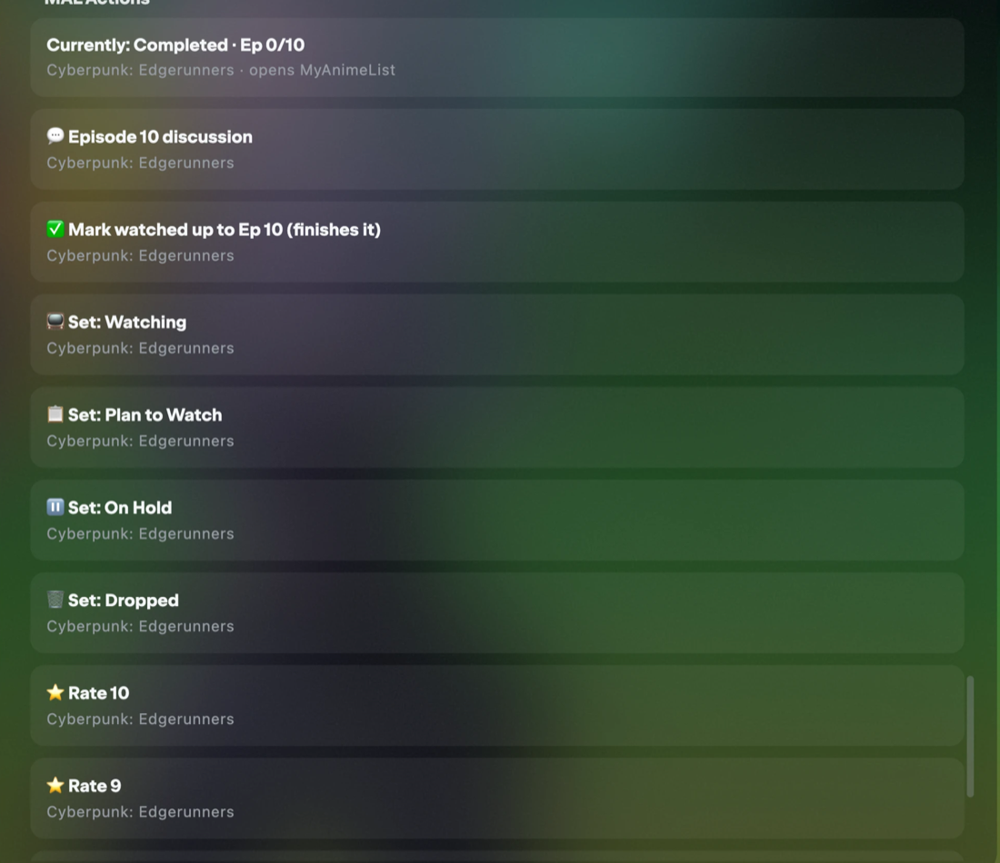
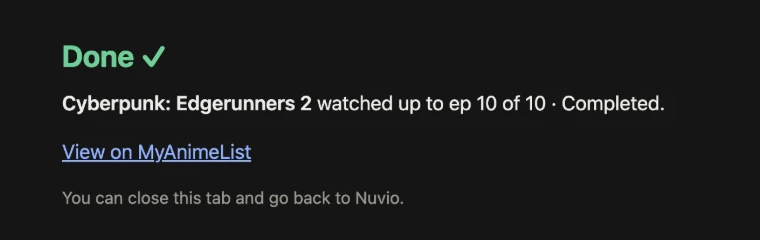
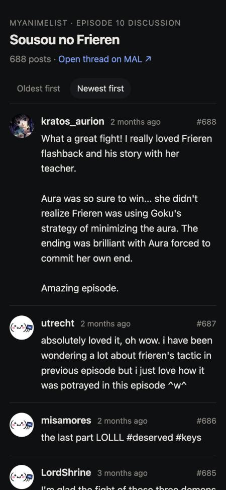
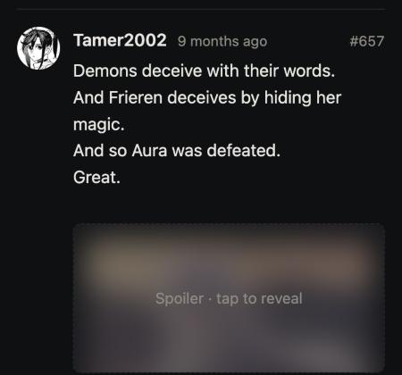
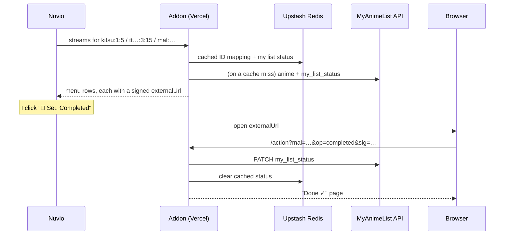

# MAL Actions

A small personal addon that lets me update my MyAnimeList entries from inside Nuvio, the app I watch
anime in. I can set a status, mark episodes watched, rate a show and read the episode's discussion
thread without leaving the episode I'm on. It also gets subtitles for anime that my subtitle addons
couldn't find before.

> The source code is private. This repo is a write-up of what it does and how it's built.

## Why I built it

MyAnimeList is where I keep track of everything I watch, and Nuvio is where I actually watch it. Keeping
the two in sync meant leaving the app, finding the show on MAL, and updating it by hand. I usually
forgot, and my list was full of shows stuck at "Watching · Ep 0" that I'd finished months ago.

Nuvio speaks the Stremio addon protocol, and that protocol has no way for an addon to add a button.
Addons can only answer a few kinds of questions, like "what streams exist for this episode?" So this
addon answers that question, but with a menu instead of streams.

## What it does

When I open an episode, a **MAL Actions** group shows up next to the normal sources, like in the
screenshot above.

- **The status line** reads my list live from MAL.
- **The menu only shows rows that would change something.** The current status is hidden, episode
  progress only moves forward, and the rating rows (★10 down to ★6) only appear once a show is
  finished or dropped. That keeps it to about six rows instead of twelve.
- **Clicking an action** opens a small confirmation page ("Done ✓, Gachiakuta set to Completed").
  MAL is already updated by the time the page loads.
- **The 💬 row** opens that episode's discussion thread from MAL's forum, on a page built for
  reading it: spoilers blurred until tapped, long posts collapsed, oldest or newest first.

- **Subtitles show up in the player's subtitle menu** for anime too. My subtitle addons only
  understand IMDb ids, and anime in Nuvio comes in with Kitsu or MAL ids, so they used to return
  nothing. This addon translates the episode and asks them for me.

  
  

## How it works

All of it is one serverless function on Vercel. Upstash Redis stores the MAL login and a few caches,
and a daily cron job keeps the login from expiring.

## The interesting problems

### Using the source list as a menu

A Stremio stream can carry an `externalUrl` instead of a video, and the app opens it in the browser.
Each menu row is a stream like that, pointing at my server. I didn't want to guess how Nuvio would
treat these rows, so I read Nuvio Desktop's source code. It showed me which fields become the label
and the subtitle, that a row with no link is silently dropped (so even the status line needs one), and
most importantly that auto-play never picks an `externalUrl`-only stream. Without that last part,
auto-play could have changed my list on its own.

I also considered sending the action as a fake "video" so no browser tab would open. Reading the
auto-play code ruled that out for the same reason: a video row can be auto-played.

### One show on IMDb, eight entries on MAL

Some apps identify episodes by IMDb ID, season and episode: `tt2560140:3:15`. MAL, on the other hand,
splits seasons into parts. Attack on Titan's season 3 is two separate MAL entries. The addon looks up
every MAL entry linked to the IMDb ID, keeps the ones for that season, and counts episodes across
the parts. So S3E15 becomes episode 3 of "Season 3 Part 2".

### MAL's OAuth quirks

MAL uses OAuth2 with PKCE, but only the `plain` method, where the challenge is just the verifier. I
checked that in the docs instead of assuming the usual `S256`. Refresh tokens last about a month, so a
quiet month would have logged me out. A daily cron job refreshes them, at most once every three days.

### The hole I found in my own design

Every action link is signed with an HMAC, so nobody can make one up. Halfway through, I realised the
signature didn't help much: the stream endpoint is public, and its whole job is to hand out signed
links. Anyone who knew the domain could install the addon and change my list.

The fix was a secret install path. The manifest and menu now only answer at
`/<key>/manifest.json`, where the key is derived from the same secret as the signatures. Other paths
return 404.

### Episode discussions from an undocumented API

MAL's forum endpoints are barely documented, so I called them first and wrote the types from the
real responses. What I found:

- **Search is loose.** A search for "Gachiakuta Episode 24 Discussion" returns every Gachiakuta
  thread. The addon matches the exact title `"{MAL title} Episode {n} Discussion"`. Because every
  season has its own MAL title, that also picks the right season.
- **The first page is slow.** MAL takes about 5 seconds to serve the first page of a thread. The menu
  starts finding the thread and loading that page in the background (with `waitUntil`), so it's
  usually already cached when I tap the row. The comment count appears in the menu after that.
- **Posts are BBCode inside HTML.** The renderer reduces every post to plain text and escapes it
  first. It then turns back on only the BBCode it recognises: quotes, spoilers, images, links and
  formatting. Nothing from a post is rendered as-is.
- **There are no likes.** MAL's API doesn't return likes or scores for forum posts.

### Subtitles for anime: translating episode numbers

Subtitle addons like OpenSubtitles only accept IMDb ids, but Nuvio identifies anime episodes by
Kitsu or MAL id, like `kitsu:12:1000`. So the addon also answers Stremio's native `subtitles`
request: it converts the episode to an IMDb season and episode, asks the subtitle addons in
parallel (8 seconds each, a slow one is skipped), then merges and dedupes the results, English first.

The hard part is the episode number. Anime and IMDb count episodes differently:

- **Split seasons:** MAL's "Attack on Titan Season 3 Part 2" starts at episode 1, but on IMDb that's
  season 3, episode 13.
- **Long shows:** One Piece is numbered straight through on MAL (episode 1000), but split into
  seasons everywhere else.

My first version guessed by counting Cinemeta's episode list, and it was one episode off for One
Piece after episode 590. The reason: TVDB files that crossover episode as a special. I fixed it in
layers:

1. [ARM](https://arm.haglund.dev) gives the IMDb id.
2. The community [Anime-Lists](https://github.com/Anime-Lists/anime-lists) XML gives the season and
   offset, including its per-episode overrides. For One Piece, episode 1000 lands in season 21 at an
   offset of 891, which makes it S21E109.
3. Every answer is checked against IMDb's episode list by air date, using Kitsu's date for the
   episode. If they're more than three days apart, the episode that aired closest to that date wins.
   That check alone also fixes the old off-by-one.

I checked the expected answers against TheTVDB's own pages, not against my code, and wrote them up
as tests: One Piece 1, 500 and 1000, Bleach 300 and Attack on Titan's final season. A small debug
endpoint shows which rule decided any episode, so I can spot-check shows. The mapping is also
started in the background when the menu loads, so it's usually cached before the player asks for
subtitles.

### Staying under two seconds

| Data | Cached for |
| --- | --- |
| Kitsu / IMDb → MAL ID mapping | 7 days (misses for 1 day) |
| My list status for a show | 2 minutes, cleared after every action |
| Forum thread ID | Permanently (the comment count refreshes every 6 hours) |
| A page of comments | 10 minutes |
| Anime → IMDb episode mapping | 7 days per show, 1 day per episode |
| Subtitle results | 1 hour |

With warm caches the menu answers in under a second.

## Stack

TypeScript · Vercel Functions · Upstash Redis · MyAnimeList API v2 ·
[ARM](https://arm.haglund.dev) and [Anime-Lists](https://github.com/Anime-Lists/anime-lists) for
anime ID and episode mapping · Cinemeta and Kitsu for episode air dates · `node:test`

## Limits

- **It's built for one user (me).** It links one MAL account.
- **No Reddit tab.** I wanted r/anime's episode threads alongside MAL's, but Reddit now requires a
  manually approved API app, so that waits.
- **No likes on the discussion page.** MAL's API doesn't provide them.
- **Some subtitle mappings can't be double-checked.** Kitsu has no air date for some episodes, so
  those rely on the Anime-Lists mapping alone.
